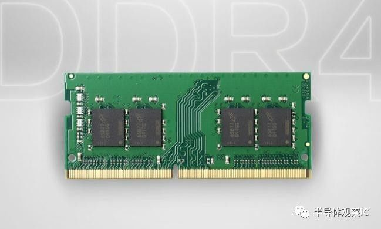
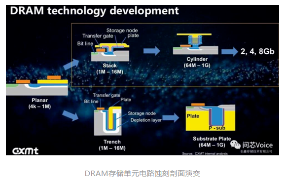
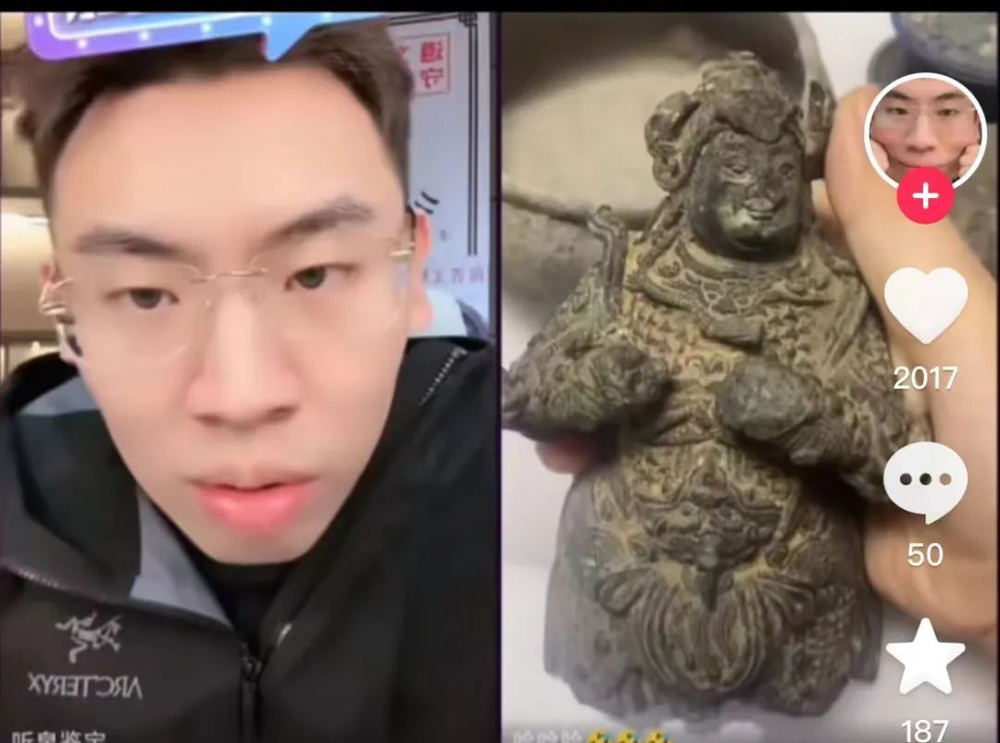
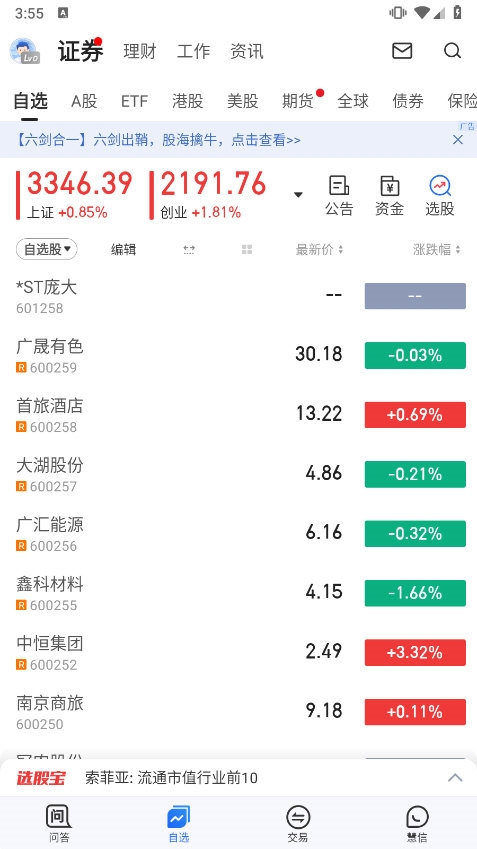
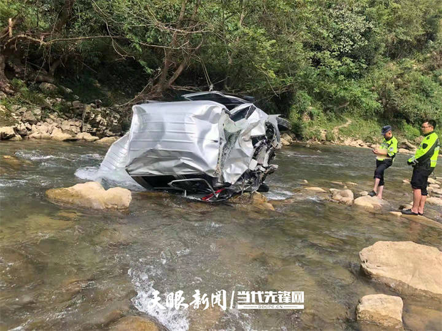
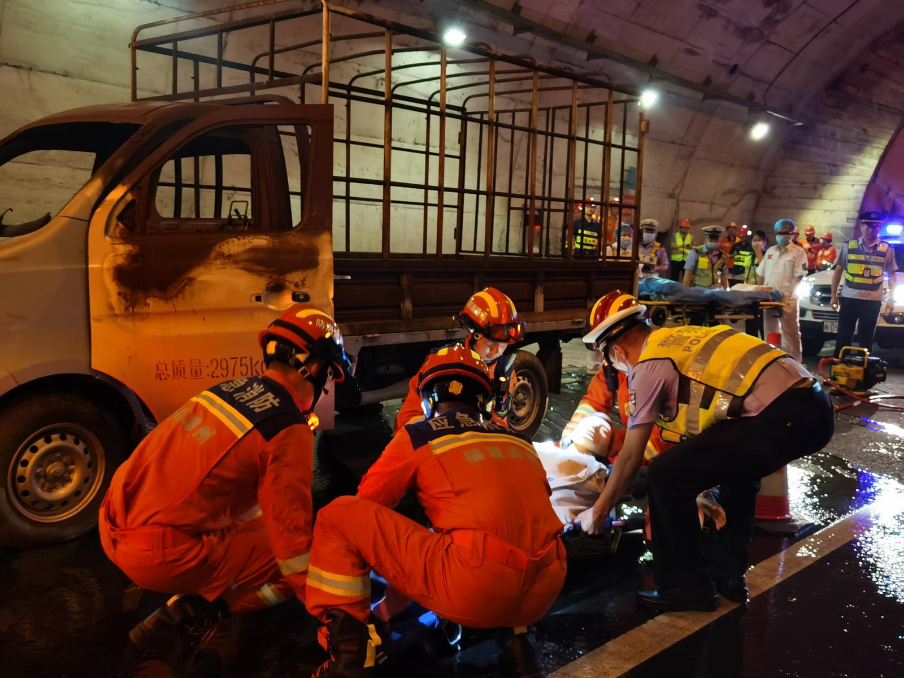

# 今日头条3篇 · 2026-07-27

> 标题复制到标题框。正文Markdown粘贴到编辑器(图片标签头条不直接渲染,需手动上传插图,位置见文中标注)。图片预览用绝对路径。

---

## 第04篇

**标题**：合肥国资赚万亿,美韩存储寡头被撕开一道口

**摘要**：长鑫科技今日登陆科创板,合肥国资账面浮盈超1万亿。300亿押注存储芯片,十年熬出国产DRAM,撕开美韩三寡头垄断。

**封面slogan**：十年押注 一朝撕口

**正文**：

长鑫科技今天正式登陆科创板,合肥国资账面浮盈超**一万亿**。一个数字摆上来,把「国资投芯片」这事从抽象口号砸成了能算的账。

这笔账怎么来的:合肥国资旗下建投、产投等平台多年累计投入约300亿,押注长鑫这家做DRAM存储芯片的公司。今天上市首日股价暴涨450%,按大猫财经Pro、史大郎等媒体的测算,合肥国资持股市值站上一万亿,7名高管跻身10亿富翁,还有至少237名千万富翁。

说真的,一万亿这个数字好看,但我更在意的是它背后那道被撕开的口子。

## 一道口子,撕在美韩三寡头身上

DRAM是内存芯片,你手机、电脑里那条运行内存,跑的就是它。这东西看着不起眼,却是全球半导体里最卷也最垄断的赛道之一。全球供给长期被三家捏着——**三星、海力士、美光**,美韩占大头,三家合计市占率长期超过九成。

长鑫做的是什么?是国产DRAM里头第一个真正能往主流市场供货的。这事的难度不光在烧钱,卡在三个地方:

- **制程与良率**:DRAM制程以10纳米级计,良率每差一个点成本差一截,是用钱堆不出来的工艺积累。
- **专利墙**:三寡头几十年布局的专利网,后来者每走一步都可能踩雷,得一条条绕、一条条谈。
- **周期与现金**:存储芯片是强周期行业,低谷期能烧到失血,撑不住就出局。

合肥国资押的不是一家公司,是冲这三道墙去的国产替代。

## 合肥模式:国资当LP,不是下场当老板

这笔万亿浮盈,真正值得讲的是合肥这套打法,长鑫只是它的一个出口。所谓合肥模式,核心一句话——**国资作LP入股不控股,按市场规则做耐心资本**。

合肥建投、产投这些国资平台,把钱以股权方式投进去,但不抢经营权、不派掌柜、不指手画脚,让专业团队干活。等企业上市或退出,国资带着回报撤或留,循环再投。京东方、蔚来、长鑫,合肥一路押过来,都是这套逻辑。

这套打法和传统补贴的区别在哪?补贴是撒钱不要回报,LP是投钱要回报还得担风险。长鑫这十年,中间满是烧钱、巨亏、被全方位封堵的至暗时刻,合肥国资没退,熬到了今天。

这十年里,美韩三寡头的垄断动是动过的,只是太慢。合肥这次把口子撕开,不是一夜之间的事,是整整十年。

讲到底,一万亿账面浮盈是数字,真要看的是这数字底下——一个国产替代的口子,被地方政府资本和一个技术团队,用十年硬撬开了。但账面归账面,存储芯片这场长跑,工艺、专利、周期,后面还有得熬。

> 万亿账面是一回事,国产替代这场长跑,才刚撕开第一道口。

---

## 第05篇

**标题**：听泉赏宝:再玩就剁手,今天起告别股市

**摘要**：千万粉丝鉴宝博主听泉赏宝直播宣布告别股市,删全部炒股软件。此前劝父母拿退休金炒股被拉黑。一个散户样本,讲透损失厌恶与赌徒谬误。

**封面slogan**：剁手戒股 散户样本

**正文**：

「再玩我就剁手。」近日,坐拥数千万粉丝的鉴宝博主听泉赏宝,在直播里突然宣布彻底告别股市,把相关炒股软件全删了。

这场告别的前情有点意思——他此前反复劝父母拿出退休金投入股市,结果被父母双双拉黑。直播里他自己也讲,「一切的烦恼源自于欲望」。

讲真,一个靠鉴宝起家的千万粉博主,炒股炒到要靠「剁手」来戒,这事看着像段子,底子是个教科书级的散户样本。

行为金融学里管散户最常踩的几个雷,头一个叫**损失厌恶**——亏一百块的痛,得赚两百块才补得回来。这是丹尼尔·卡尼曼和阿莫斯·特沃斯基1979年提出的「前景理论」核心,卡尼曼后来凭这套研究拿了诺贝尔经济学奖。人对盈亏的反应是不对称的:赚的快乐淡,亏的痛扎心。

所以人亏了不爱卖,卖了就等于把「浮亏」坐实成「真亏」,这就叫**处置效应**,俗称卖盈持亏。学者奥丁(terrance Odean)曾扒过一万户散户账户,发现大伙卖出盈利股的概率,是卖出亏损股的1.5倍——赚的急着落袋,亏的死扛到底,结果组合里剩的全是烂牌。

再往深一层,是**赌徒谬误**——连亏几把就觉得「该轮到我赢了」,其实每一笔交易都是独立事件,概率从来不欠你。听泉劝父母拿退休金入场,赌的多半就是「该回本了」这道错觉。

顺带说一句,听泉本行是鉴宝。古玩和股票有一点像,都吃「信息差」和「故事感」,但古玩好歹有个实物锚着底,股票没有——它的价格飘在预期上,预期的底部比古玩还虚。一个靠讲故事起家的人,栽在另一个讲故事的市场里,不算偶然。

这事里谁得利谁受损,账其实很清楚:网红带话题赚流量,跟单的粉丝各凭本事,真正被架到火上烤的,是被劝进场的父母——退休金是输不起的钱。

更扎心的是,网红带粉丝炒股,本质是把「投资决策」做成了「内容消费」。粉丝跟单,大多不是研究过公司,是看戏看上头。戏散了,票还在手里。

要是父母退休金真跟进去,赶上一波大跌,这事就不是「剁手」能收场的了。散户最大的坑,从来不在亏多少,在用了不该用的钱。

听泉自己告别股市,是真戒还是又一场流量,这事暂时没个准信。*一个千万粉的鉴宝博主,戒得了股市,戒得了流量吗?*

> 这账,最后谁算得清?

---

## 第06篇

**标题**：蜜月悬崖边一辆侧翻车,常州小夫妻冲了上去

**摘要**：常州新婚夫妻蜜月途中遇悬崖边侧翻事故车,丈夫撇下妻子冲上去救人,妻子反向求援。讲透侧翻施救四道关:防二次事故、判车况、抢黄金时间、避搬运禁忌。

**封面slogan**：冲上去的人 搬救兵的人

**正文**：

蜜月路上,一辆侧翻的事故车横在悬崖边,一对新婚夫妻的车停了下来。这是常州一对刚结婚的小夫妻,蜜月途中撞上的一幕。

## 冲上去的人

丈夫没多想,突然停车,撇下新婚妻子,冲向那辆侧翻在悬崖边的事故车。妻子望着他的背影消失在路边,转头跑向反方向,去寻更多支援。

一个小时后,丈夫满身泥泞地回来。妻子没有一句抱怨。

实话说,冲上去这动作值得敬,但悬崖边救人,光有热血不够,有几道科学关得把住:

- **先防二次事故**:事故车停在悬崖边,第一件事是开双闪、放三角牌,提醒后车,别让救人的人变成被撞的人。二次事故在救援里死人,比头一次还多。
- **判车况再动手**:侧翻车辆先看有无起火、漏油,确认车身稳定、不再翻动,才能从稳定侧接近伤员。盲目拽人,车再翻一次,人没救成搭自己。
- **抢黄金时间**:心搏骤停4分钟内做心肺复苏,大出血5分钟内止血,这几分钟比赶到医院还值钱。专业的救援,得知道这窗口在哪。
- **搬运禁忌**:脊柱、颈椎有损伤的伤员,没专业器械别硬搬。正确做法是「轴线翻身」、上颈托固定,原地制动等专业救援。搬错一步可能终身瘫痪。等来专业救援,有时比动手更重要。

这四道关,核心就一条——先保证现场安全,再谈救人。很多人栽就栽在跳过第一步、直接上手。悬崖边的事故车不是平地,二次翻动、坠崖、起火,每一项都能把救人者变成被救者。

## 往反方向跑的人

我们看这对夫妻的分工,其实暗合了救援里最被忽视的一条——一个人冲上去救,一个人去搬救兵。很多人遇险第一反应是闷头干,忘了求助本身也是救援的一半。会喊救命,和会救人一样值钱。

代价这边也得算。一个刚结婚的人冲向悬崖边的事故车,万一车辆二次翻动、起火,搭上的可能是两个家庭。勇气可敬,但勇气和风险之间,差的往往就是那几道科学关——能不能先设警示、先判车况,决定了这是英雄故事还是二次伤亡。

泥泞的丈夫回来了,妻子没说话,递了瓶水。两个人又上了自己的车,继续这趟被打断的蜜月。

> 悬崖边那个背影,和反方向跑着的那个身影,是新婚这条路上,最深的一道画面。

---

## 图片清单(绝对路径,可直接拖入头条上传框)

- /Users/zcy1/code_self/AI/project/tt-redian-text/input/04-长鑫合肥国资万亿-内图1.jpg
- /Users/zcy1/code_self/AI/project/tt-redian-text/input/04-长鑫合肥国资万亿-内图2.jpg
- /Users/zcy1/code_self/AI/project/tt-redian-text/input/04-长鑫合肥国资万亿.jpg
- /Users/zcy1/code_self/AI/project/tt-redian-text/input/05-听泉赏宝告别股市-内图1.jpg
- /Users/zcy1/code_self/AI/project/tt-redian-text/input/05-听泉赏宝告别股市-内图2.jpg
- /Users/zcy1/code_self/AI/project/tt-redian-text/input/05-听泉赏宝告别股市.jpg
- /Users/zcy1/code_self/AI/project/tt-redian-text/input/06-新婚夫妻悬崖救人-内图1.jpg
- /Users/zcy1/code_self/AI/project/tt-redian-text/input/06-新婚夫妻悬崖救人-内图2.jpg
- /Users/zcy1/code_self/AI/project/tt-redian-text/input/06-新婚夫妻悬崖救人.jpg
